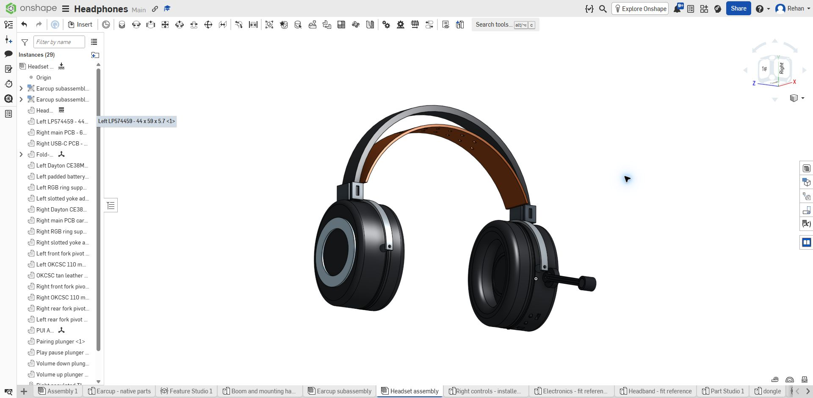

# Headphones

I wanted to make my own over-ear headphones and learn how to fit the audio electronics, battery, and controls into something I could actually wear. I also wanted a fold-up mic and RGB around the cups.

The cups are closed-back and use 40 mm Dayton drivers, an adjustable OKCSC headband, and Brainwavz memory-foam pads. There are 16 LEDs in each cup. The headset can pair with a phone over Bluetooth or use a USB dongle for PC audio and the boom mic. The headset's USB-C port handles charging and wired SignalRGB.

## Files

- [BOM](BOM.md) and [CSV](BOM.csv)
- [Onshape and STEP files](CAD/)
- [KiCad projects and fabrication files](PCB/fabrication/)
- [Wiring](PCB/Harness%20wiring.md) and [RGB power](PCB/LED%20rail%20protection.md)
- [Headset firmware](code/headset/) and [dongle firmware](code/dongle/)
- [SignalRGB plugin](code/signalrgb/Headphones.js)

## How to build it

1. Order the boards from the [fabrication folders](PCB/fabrication/). You need one of each board and two copies of the RGB ring. Check the board thicknesses before ordering.
2. Print the parts from [Onshape](CAD/). Dry-fit the headband, pads, baffles, and battery wiring before committing to the final cup prints. The deeper baffles still need a fit check with the actual battery and thermistor.
3. Solder the boards and run the wires using the [pinout](PCB/Harness%20wiring.md). The main board has a few parts to leave off, so check the [assembly notes](PCB/fabrication/README.md#before-assembly) first. Try the BM83 soldering setup on a spare board.
4. Check for shorts and confirm battery polarity before plugging anything in. Start with a current-limited supply and leave the battery and RGB rings disconnected.
5. Flash the [headset](code/headset/) and [dongle](code/dongle/) over SWD. Measure the dongle's reference voltage first and use a probe that supports 1.8 V.
6. Try audio and the flip-up mic in both modes, then check charging and RGB. Make sure your ears clear the grilles when the pads compress before closing up the cups.

## BOM

One build comes to about **$306.35**, including $25 for printing and its shipping. If you need calipers, add $11.99 for a **$318.34** total. The selector seal, other shipping, tax, and extra bench tools are separate. [Caliper](https://www.harborfreight.com/painting/measuring-marking/calipers-micrometer/6-in-composite-digital-caliper-63586.html) [Pricing sheet](https://docs.google.com/spreadsheets/d/1EZlvAER-2UgOb8yQGnecRwhJc7PUS93z2gQPCFvvkVY/edit)

| Item | Quantity | Description | Link | Unit price (USD) | Total price (USD) | Notes |
| --- | --- | --- | --- | --- | --- | --- |
| OKCSC 110 mm padded headband | 1 | Adjustable headband and yokes | [Buy](<https://www.aliexpress.us/item/3256810368016901.html>) | $29.00 | $29.00 |  |
| Brainwavz Oval Micro Suede BWAVZ-OVLBKMS-BAR | 1 | Black foam pair. 110 × 90 × 30 mm, 70 × 50 mm opening. | [Buy](<https://www.brainwavzaudio.com/collections/accessories/products/headphone-memory-foam-earpads-oval-micro-suede>) | $18.55 | $18.55 | Rear mounting flap. |
| Dayton CE38MB-32 drivers | 2 | 40 mm nominal, 32 Ω each | [Buy](<https://www.parts-express.com/Dayton-Audio-CE38MB-32-1-1-2-Mini-Speaker-Black-32-Ohm-285-131>) | $3.49 | $6.98 | Sold individually. |
| Ebyte E73-2G4M08S1C | 2 | 2.4 GHz nRF52840 radio and MCU | [Buy](<https://www.robotshop.com/products/ebyte-e73-2g4m08s1c-iot-solutions-modules-nrf52840-ble50-smd-24ghz-nordic-wireless-module>) | $6.50 | $13.00 | One per board. |
| Microchip BM83SM1-00AB | 1 | Bluetooth Classic and headphone driver | [Buy](<https://www.digikey.com/en/products/detail/microchip-technology/BM83SM1-00AB/12823501>) | $13.18 | $13.18 |  |
| TI TLV320AIC3204IRHBR | 1 | Stereo codec with headphone amplifier | [Buy](<https://www.digikey.com/en/products/detail/texas-instruments/TLV320AIC3204IRHBR/1952545>) | $5.59 | $5.59 |  |
| TI TS5A22362DGSR | 3 | Speaker and mic/bias selection | [Buy](<https://www.lcsc.com/product-detail/Analog-Switches-Multiplexers_Texas-Instruments-TS5A22362DGSR_C201663.html>) | $0.9538 | $2.86 | LCSC part C201663. |
| PUI AOM-4544P-2-R capsules | 2 | One boom mic and one ambient mic | [Buy](<https://www.digikey.com/en/products/detail/pui-audio-inc/AOM-4544P-2-R/1745492>) | $1.48 | $2.96 | One capsule per mic. |
| TI BQ24074RGTR | 1 | 1S 4.20 V charger and power path | [Buy](<https://www.digikey.com/en/products/detail/texas-instruments/BQ24074RGTR/2047269>) | $2.43 | $2.43 | About 500 mA charge. USB starts at 100 mA, then about 390 mA after setup. |
| TI TPS63031DSKR | 1 | 3.3 V buck-boost supply | [Buy](<https://www.lcsc.com/product-detail/dc-dc-converters_texas-instruments-tps63031dskr_C15516.html>) | $1.0429 | $1.04 | LCSC part C15516. |
| Adafruit 2011 protected 1S pack | 1 | 2000 mAh, 3.7 V, 60 × 36 × 7 mm | [Buy](<https://www.digikey.com/en/products/detail/adafruit-industries-llc/2011/6612469>) | $12.50 | $12.50 | Battery for this build. Tray fit pending. |
| Semitec 103AT-2 thermistor | 1 | 10 kΩ at 25 °C, B3435 NTC for charger TS | [Buy](<https://www.digikey.com/en/products/detail/semitec-usa-corp/103at-2/16579059>) | $0.68 | $0.68 | External battery temperature sensor. |
| Adafruit 3814 battery pigtail | 1 | 2-pin JST-PH mating adapter for the 2011 | [Buy](<https://www.digikey.com/en/products/detail/adafruit-industries-llc/3814/9380221>) | $0.75 | $0.75 | Mates with the battery’s original plug. |
| TI TPS61023DRLR | 1 | 5 V boost for both RGB rings | [Buy](<https://www.digikey.com/en/products/detail/texas-instruments/TPS61023DRLR/11310629>) | $1.38 | $1.38 | U5 makes 5 V for the rings. 300 mA LED budget. |
| TI TPS2553DBVR-1 | 1 | U13 hardware cutoff for both LED rings | [Buy](<https://www.digikey.com/en/products/detail/texas-instruments/TPS2553DBVR-1/2047901>) | $1.06 | $1.06 | -1 latch-off version, SOT-23-6. R210 sets the limit. |
| 68.1 kΩ 0603 · Yageo RC0603FR-0768K1L | 1 | R210 sets the LED cutoff threshold | [Buy](<https://www.digikey.com/en/products/detail/yageo/RC0603FR-0768K1L/727354>) | $0.10 | $0.10 | 1%. Expected trip at 0.34–0.44 A. |
| TI SN74AHCT1G125DBVR | 1 | 3.3 V to 5 V RGB data buffer | [Buy](<https://www.digikey.com/en/products/detail/texas-instruments/SN74AHCT1G125DBVR/376028>) | $0.14 | $0.14 |  |
| TI TLV803EA29DBZR | 1 | BM83 2.93 V open-drain reset supervisor | [Buy](<https://www.digikey.com/en/products/detail/texas-instruments/TLV803EA29DBZR/11308855>) | $0.50 | $0.50 |  |
| Bourns SRN4018-1R5Y | 1 | 1.5 µH inductor for 3.3 V supply | [Buy](<https://www.digikey.com/en/products/detail/bourns-inc/SRN4018-1R5Y/3821618>) | $0.37 | $0.37 |  |
| Bourns SRN6045TA-1R0Y | 1 | 1.0 µH inductor for 5 V boost | [Buy](<https://www.digikey.com/en/products/detail/bourns-inc/SRN6045TA-1R0Y/6155099>) | $0.46 | $0.46 |  |
| Kyocera KC3225K12.2880C1GE00 | 1 | 12.288 MHz, 3.3 V codec master clock (Y1) | [Buy](<https://www.digikey.com/en/products/detail/kyocera-avx/KC3225K12-2880C1GE00/5322447>) | $1.39 | $1.39 | Cut tape. C212 bypass. |
| Amphenol 12401610E4#2A | 1 | USB-C headset receptacle | [Buy](<https://www.digikey.com/en/products/detail/amphenol-icc-commercial-products/12401610E4-2A/5775520>) | $1.43 | $1.43 |  |
| ST USBLC6-2SC6 | 1 | Headset USB data ESD array | [Buy](<https://www.digikey.com/en/products/detail/stmicroelectronics/USBLC6-2SC6/1040559>) | $0.54 | $0.54 |  |
| Nexperia PESD5V0U2BT-QR | 1 | Dongle USB D+ and D− ESD protection | [Buy](<https://www.digikey.com/en/products/detail/nexperia-usa-inc/PESD5V0U2BT-QR/17296191>) | $0.31 | $0.31 | Dongle D1 goes on the bottom (SOT-23). |
| Molex 1054440011 | 1 | Right-angle USB-C dongle plug | [Buy](<https://www.digikey.com/en/products/detail/molex/1054440011/6173183>) | $3.10 | $3.10 |  |
| Amphenol 10165794-Z0100YBLF USB-C cable | 1 | 1 m black USB-C to USB-C. USB 2.0 data and 5 V charging. | [Buy](<https://www.digikey.com/en/products/detail/amphenol-cs-fci/10165794-Z0100YBLF/22527932>) | $4.67 | $4.67 | Max plug body is 11.2 × 6.7 mm. Fits the 14.5 × 8.0 mm CAD opening. |
| Worldsemi WS2812B-B/W | 35 | Buy 35 to populate 32 pixels | [Buy](<https://www.lcsc.com/product-detail/C114586.html>) | $0.1042 | $3.65 | 32 LEDs used, 3 spare. |
| E-Switch TL3342F260QG | 5 | Four earcup controls and one main board reset switch | [Buy](<https://www.digikey.com/en/products/detail/e-switch/TL3342F260QG/6596498>) | $0.62 | $3.10 | Play/pause, volume +/−, pair, and mainboard reset. |
| C&K JS102011SAQN | 1 | Two-position Bluetooth/dongle selector | [Buy](<https://www.digikey.com/en/products/detail/c-k/JS102011SAQN/1640095>) | $0.90 | $0.90 | 2 mm travel. 1.0 mm selector PCB. |
| C&K 1101M1S3ZQE2 master power switch | 1 | Maintained slide switch connects main SW1 VSYS to SYS_SW | [Buy](<https://www.digikey.com/en/products/detail/c-k/1101M1S3ZQE2/67048>) | $8.05 | $8.05 | 6 A resistive at 28 VDC. Onshape M1. |
| Aratas / Omron B3F-1000 boom mute switch | 1 | 6 × 6 mm normally-open through-hole tact. Boom cam holds contact closed when deployed. | [Buy](<https://www.digikey.com/en/products/detail/aratas-formerly-omron-components/B3F-1000/33150>) | $0.35 | $0.35 | Mute switch on SW7 pads 1–2. Boom mic on J7. |
| Sullins PEC36SAAN 2.54 mm headers | 1 | 36-pin breakaway strip for the service headers | [Buy](<https://www.digikey.com/en/products/detail/sullins-connector-solutions/PEC36SAAN/859153>) | $1.44 | $1.44 | 8 pins used for J2 and J4. |
| Adafruit 5087 3-pin inline disconnect | 1 | Matched JST-PH-compatible 26 AWG pigtail pair | [Buy](<https://www.digikey.com/en/products/detail/adafruit-industries-llc/5087/14652853>) | $0.95 | $0.95 | Matched pair for the battery and temp sensor. |
| Qualtek Q2-Z-RK1-3/32-01-6IN-32 | 1 | 3/32 in black 2:1 heat shrink | [Buy](<https://www.digikey.com/en/products/detail/qualtek/Q2-Z-RK1-3-32-01-6IN-32/1210238>) | $1.38 | $1.38 | For small splices. |
| Qualtek Q2-Z-RK1-1/8-01-6IN-28 | 1 | 1/8 in black 2:1 heat shrink | [Buy](<https://www.digikey.com/en/products/detail/qualtek/Q2-Z-RK1-1-8-01-6IN-28/1210237>) | $1.52 | $1.52 | For thicker splices. |
| Qualtek Q2-Z-RK1-3/16-01-6IN-24 | 1 | 3/16 in black 2:1 heat shrink | [Buy](<https://www.digikey.com/en/products/detail/qualtek/Q2-Z-RK1-3-16-01-6IN-24/1210246>) | $1.59 | $1.59 | For larger lugs. |
| Adafruit 3892 flexible headband wire | 3 | Black stranded silicone 26 AWG. Each pack has four separate 1 m conductors. | [Buy](<https://www.digikey.com/en/products/detail/adafruit-industries-llc/3892/9603618>) | $1.95 | $5.85 | 9 wires through the headband. Ø1.5 ±0.1 mm each. |
| Lite-On LTST-C170KGKT | 1 | Dongle status indication | [Buy](<https://www.digikey.com/en/products/detail/liteon/LTST-C170KGKT/386776>) | $0.19 | $0.19 |  |
| 100 nF 0805 · Würth 885012207098R | 50 | Bypass | [Buy](<https://www.digikey.com/en/products/detail/w%C3%BCrth-elektronik/885012207098R/21719484>) | $0.0302 | $1.51 | 49 used. |
| 100 pF 0805 · KEMET C0805C101J5GACTU | 2 | Capacitors C27 and C29 | [Buy](<https://www.digikey.com/en/products/detail/kemet/C0805C101J5GACTU/411397>) | $0.19 | $0.38 | C0G, 50 V, ±5%. |
| 220 pF 0805 · KEMET C0805C221J5GACTU | 1 | Feed-forward capacitor across the RGB boost feedback upper resistor | [Buy](<https://www.digikey.com/en/products/detail/kemet/C0805C221J5GACTU/411402>) | $0.20 | $0.20 | C31. C0G, 50 V, ±5%. |
| 1 µF 0805 · Samsung CL21B105KOFNFNE | 10 | Coupling and bypass | [Buy](<https://www.digikey.com/en/products/detail/samsung-electro-mechanics/CL21B105KOFNFNE/3891016>) | $0.0590 | $0.59 | 7 used, 3 spare. |
| Murata GRM1885C1H103JA01J | 1 | 10 nF C0G 0603 bypass for the 12.288 MHz clock | [Buy](<https://www.digikey.com/en/products/detail/murata-electronics/GRM1885C1H103JA01J/4905215>) | $0.1300 | $0.13 | Main C212 next to Y1. 50 V, ±5%. |
| 1 µF 0603 · Yageo CC0603KRX7R7BB105 | 2 | C211 BM83 mic-bias bypass and C213 LED protection switch bypass | [Buy](<https://www.digikey.com/en/products/detail/yageo/CC0603KRX7R7BB105/2833611>) | $0.24 | $0.48 | X7R, 16 V, ±10%, 0603. |
| 4.7 µF 0805 · Samsung CL21B475KAFNNNE | 2 | Main charger input and dongle USB VBUS/VDDH bypass | [Buy](<https://www.digikey.com/en/products/detail/samsung-electro-mechanics/CL21B475KAFNNNE/3888627>) | $0.50 | $1.00 | 25 V X7R. Main C1 and dongle C1. |
| 10 µF 0805 · Samsung CL21B106KOQNNNE | 13 | Supply bypass and stabilization, 12 main and one dongle | [Buy](<https://www.digikey.com/en/products/detail/samsung-electro-mechanics/CL21B106KOQNNNE/3890958>) | $0.17 | $2.15 | Dongle C2 on VDD. X7R, 16 V, ±10%, 1.40 mm max. |
| 22 µF 0805 · Samsung CL21A226MPQNNNE | 3 | Boost and BM83 supply bypass | [Buy](<https://www.digikey.com/en/products/detail/samsung-electro-mechanics/CL21A226MPQNNNE/3888568>) | $0.19 | $0.57 | 10 V X5R. |
| 47 µF · Nichicon UWT1V470MCL1GS | 2 | One bulk capacitor on each LED ring | [Buy](<https://www.digikey.com/en/products/detail/nichicon/UWT1V470MCL1GS/589943>) | $0.44 | $0.88 | One C52 per ring. 35 V, ±20%, Ø6.3 × 5.8 mm. |
| 220 µF · Nichicon UWT0J221MCL6GS | 2 | Codec headphone DC blocking | [Buy](<https://www.digikey.com/en/products/detail/nichicon/UWT0J221MCL6GS/2550846>) | $0.39 | $0.78 | C24, C25. |
| 33 Ω 0805 · RC0805FR-0733RL | 10 | RGB/UART series | [Buy](<https://www.digikey.com/en/products/detail/yageo/RC0805FR-0733RL/730809>) | $0.0340 | $0.34 | 5 used. |
| 330 Ω 0805 · RC0805FR-07330RL | 2 | RGB data series | [Buy](<https://www.digikey.com/en/products/detail/yageo/RC0805FR-07330RL/727866>) | $0.10 | $0.20 |  |
| 1 kΩ 0805 · RC0805FR-071KL | 1 | Dongle status LED | [Buy](<https://www.digikey.com/en/products/detail/yageo/RC0805FR-071KL/727444>) | $0.10 | $0.10 | Dongle R5. |
| 1.78 kΩ 0805 · CRCW08051K78FKEA | 1 | Charge programming | [Buy](<https://www.digikey.com/en/products/detail/vishay-dale/CRCW08051K78FKEA/1175663>) | $0.10 | $0.10 | R1. |
| 2.2 kΩ 0805 · RC0805FR-072K2L | 2 | Electret bias | [Buy](<https://www.digikey.com/en/products/detail/yageo/RC0805FR-072K2L/727676>) | $0.10 | $0.20 | R18 and R19. |
| 3.92 kΩ 0805 · RC0805FR-073K92L | 1 | Main R2 charger input-current limit | [Buy](<https://www.digikey.com/en/products/detail/yageo/RC0805FR-073K92L/727840>) | $0.10 | $0.10 | 1%. Sets the configured USB input limit. R1 sets charge current. |
| 4.7 kΩ 0805 · RC0805FR-074K7L | 3 | Digital pull-up and bias | [Buy](<https://www.digikey.com/en/products/detail/yageo/RC0805FR-074K7L/727929>) | $0.10 | $0.30 |  |
| 5.1 kΩ 0805 · CRCW08055K10FKEA | 3 | USB-C CC terminations | [Buy](<https://www.digikey.com/en/products/detail/vishay-dale/CRCW08055K10FKEA/1180863>) | $0.10 | $0.30 | USB-C CC. |
| 10 kΩ 0805 · RC0805FR-0710KL | 10 | Bias and pull resistors | [Buy](<https://www.digikey.com/en/products/detail/yageo/RC0805FR-0710KL/727535>) | $0.0340 | $0.34 | 5 used. |
| 46.4 kΩ 0805 · RC0805FR-0746K4L | 1 | Charger timer programming | [Buy](<https://www.digikey.com/en/products/detail/yageo/RC0805FR-0746K4L/727969>) | $0.10 | $0.10 | R3. |
| 100 kΩ 0805 · Yageo RC0805FR-07100KL | 10 | Mode and other pull resistors | [Buy](<https://www.digikey.com/en/products/detail/yageo/RC0805FR-07100KL/730491>) | $0.0360 | $0.36 | 8 used. |
| 732 kΩ 0805 · RC0805FR-07732KL | 1 | Boost feedback | [Buy](<https://www.digikey.com/en/products/detail/yageo/RC0805FR-07732KL/728131>) | $0.10 | $0.10 | R22. |
| 56 kΩ 0805 · Yageo RC0805FR-0756KL | 1 | Main R10 lower battery-sense resistor | [Buy](<https://www.digikey.com/en/products/detail/yageo/RC0805FR-0756KL/728033>) | $0.10 | $0.10 | 1%. |
| 1 MΩ 0805 · RC0805FR-071ML | 1 | Main R9 upper battery-sense resistor | [Buy](<https://www.digikey.com/en/products/detail/yageo/RC0805FR-071ML/727445>) | $0.10 | $0.10 | R9 = 1 MΩ, R10 = 56 kΩ. At 4.2 V, ADC stays below 0.23 V with 1% parts. |
| DoonX 0.4 mm black silicone sheet | 1 | Selector seal stock | [Buy](<https://www.doonx.com/products/0-4mm-black-silicone-rubber-sheet>) |  |  | $0.56 before choosing a cut size. |
| ServoCity 2929-0216-0352 silicone sheet | 1 | 216 × 352 mm, 1 mm thick, 30A, adhesive backed | [Buy](<https://www.servocity.com/adhesive-backed-silicone-rubber-sheet-30a-durometer-1mm-thickness-216mm-x-352mm/>) | $11.99 | $11.99 | Baffle gasket material. |
| Kunin 893818 black 1 mm polyester felt | 1 | Matched left and right damping samples | [Buy](<https://www.hobbylobby.com/fabric-sewing/craft-fabrics/felt-fabric-sheets/black---felt-sheet---1mm/p/80957611>) | $0.25 | $0.25 | One 9 × 12 in sheet for both cups. |
| CNC Kitchen TC-M2x3.0 insert pack | 1 | M2 × 3 heat-set insert kit | [Buy](<https://cnckitchenus.store/products/heat-set-insert-m2-x-3-100-pieces>) | $11.50 | $11.50 | 100 per pack. |
| Olander .2C5SHCS M2 × 5 screws | 5 | M2 × 0.4 DIN 912 stainless socket cap | [Buy](<https://www.olander.com/items/.2C5SHCS>) | $0.213 | $1.07 | 2 for the selector, 1 for the boom guard, 2 for the power slide. |
| Olander .2CHNTS M2 hex nuts | 2 | Stainless M2 × 0.4, 4 mm AF, 1.60 mm max thick | [Buy](<https://www.olander.com/items/.2CHNTS>) | $0.095 | $0.19 | For the power slide. |
| Panduit PLT1M-M300 black nylon ties | 3 | Cable strain relief and connector shelf retention | [Buy](<https://www.digikey.com/en/products/detail/panduit-corp/PLT1M-M300/451182>) | $0.12 | $0.36 | 99.06 × 2.50 mm. Two for the bridge, one for the connector shelf. |
| TLBZK 8858+ hot-air rework station | 1 | 110 V station with adjustable temperature and airflow | [Buy](<https://www.ebay.com/itm/157518504793>) | $29.99 | $29.99 | For soldering the mainboard. Free shipping listed. |
| All 3D-printed parts and printing | 1 | Matte-black closed-back cups, mounts and dongle case | [Rates](<https://printlegion.hackclub.com/docs/printers>) | $25.00 | $25.00 | Provisional $25. About 300 g of filament plus print shipping. |
| Custom PCB fabrication | 7 | 1 main + 1 USB-C + 2 RGB rings + 1 dongle + 1 buttons + 1 mode selector |  | See pricing tab |  | $38.70 before shipping for 5 of each design. |
| Custom PCB assembly | 7 | Populate seven boards including the C&K mode selector |  | See pricing tab |  | Home assembly for this build. |
